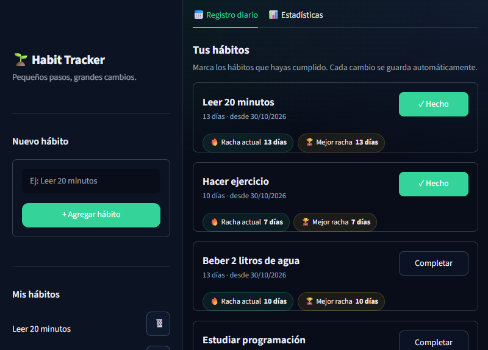
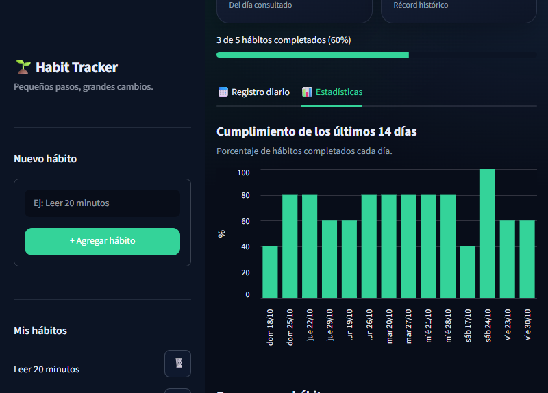

# 🌱 Habit Tracker – Rastreador de Hábitos

Una aplicación web sencilla para crear hábitos, marcar su cumplimiento cada día y
consultar tu progreso mediante rachas y estadísticas.

El proyecto está pensado como una primera aplicación completa de portafolio:
usa **Python**, **SQLite** y **Streamlit**, no necesita servidores externos y
guarda todos los datos de forma local.

> **Idea central:** la constancia importa más que la perfección. Marca un hábito
> cada día y deja que las rachas te ayuden a mantener el ritmo.

---

## 📸 Capturas de pantalla

| Registro diario | Estadísticas |
|:---:|:---:|
|  |  |

Las capturas muestran datos de ejemplo. Tus hábitos se guardan únicamente en
tu equipo.

---

## ✨ Características principales

- **Gestión de hábitos:** agrega hábitos con nombres personalizados y elimina
  los que ya no necesites.
- **Registro diario:** marca o desmarca cada hábito para el día de hoy o para
  cualquier día anterior.
- **Guardado automático:** cada cambio se almacena al instante en SQLite.
- **Sin duplicados:** un hábito solo puede registrarse una vez por día.
- **Rachas:** calcula la racha actual y la mejor racha histórica de cada hábito.
- **Estadísticas:** muestra el total de hábitos, los completados del día, el
  porcentaje de cumplimiento y la mejor racha conseguida.
- **Historial visual:** gráfico de los últimos 14 días y tablas con el detalle
  de los últimos días.
- **Interfaz oscura y responsive:** tarjetas, indicadores de progreso y un
  diseño limpio creado con Streamlit.

## 🛠️ Tecnologías utilizadas

| Tecnología | Uso |
|---|---|
| [Python 3](https://www.python.org/) | Lógica de la aplicación |
| [SQLite](https://www.sqlite.org/) | Base de datos local y persistente |
| [Streamlit](https://streamlit.io/) | Interfaz web interactiva |

No se utilizan APIs externas, credenciales ni servicios de terceros.

## ✅ Requisitos

- Python **3.11 o superior**.
- `pip` para instalar las dependencias.
- No hace falta instalar un servidor de base de datos: SQLite viene incluido
  con Python.

## 🚀 Instalación y ejecución

1. Clona el repositorio:

   ```bash
   git clone https://github.com/TU-USUARIO/Habit-Tracker.git
   cd Habit-Tracker
   ```

2. Crea y activa un entorno virtual (recomendado):

   **Windows (PowerShell):**

   ```powershell
   python -m venv .venv
   .venv\Scripts\Activate.ps1
   ```

   **macOS / Linux:**

   ```bash
   python3 -m venv .venv
   source .venv/bin/activate
   ```

3. Instala las dependencias:

   ```bash
   pip install -r requirements.txt
   ```

4. Ejecuta la aplicación:

   ```bash
   streamlit run app.py
   ```

5. Streamlit abrirá la aplicación en el navegador, normalmente en
   `http://localhost:8501`.

### Comandos rápidos

```bash
pip install -r requirements.txt
streamlit run app.py
```

## 📖 Cómo utilizar la aplicación

1. **Crea un hábito** desde el formulario de la barra lateral. Por ejemplo:
   _Leer 20 minutos_, _Hacer ejercicio_ o _Beber 2 litros de agua_.
2. **Marca el hábito** con el botón “Marcar hecho”. El registro se guarda
   automáticamente.
3. **Consulta otro día** con el selector de fecha de la cabecera. Puedes
   revisar y editar días anteriores, pero no fechas futuras.
4. **Desmarca un hábito** pulsando “✓ Completado” si lo marcaste por error.
5. **Revisa tus estadísticas** en la pestaña “Estadísticas”: progreso diario,
   rachas y historial.
6. **Elimina un hábito** con el botón 🗑️ de la barra lateral. También se
   eliminarán sus registros asociados.

### ¿Cómo se calculan las rachas?

- La **racha actual** cuenta los días consecutivos completados hasta hoy.
- Si el hábito se completó **hoy o ayer**, la racha sigue activa: todavía queda
  tiempo para completar el día de hoy.
- Si la última marca fue **antes de ayer**, la racha actual vuelve a cero.
- La **mejor racha** es la secuencia más larga de días consecutivos registrada
  históricamente para ese hábito.

## 📁 Estructura del proyecto

```text
Habit-Tracker/
│
├── app.py                  # Interfaz principal de Streamlit
├── database.py             # Conexión y creación de la base de datos SQLite
├── habit_manager.py        # Hábitos, registros, rachas y estadísticas
├── requirements.txt        # Dependencias del proyecto
├── README.md               # Documentación
├── .gitignore              # Archivos que no se suben a GitHub
│
├── screenshots/            # Imágenes utilizadas en el README
│   ├── registro-diario.png
│   └── estadisticas.png
│
└── .streamlit/
    └── config.toml         # Tema oscuro y configuración de Streamlit
```

La base de datos `habits.db` se crea automáticamente la primera vez que se
ejecuta la aplicación. No se sube al repositorio porque contiene tus datos
personales y está incluida en `.gitignore`.

## 🗄️ Base de datos

El proyecto utiliza dos tablas:

- **`habits`**: guarda el identificador, el nombre y la fecha de creación de
  cada hábito.
- **`habit_records`**: guarda qué hábito se completó en qué fecha.

La combinación de `habit_id` y `record_date` es única, lo que evita registros
duplicados para el mismo hábito y día. Además, al eliminar un hábito se eliminan
sus registros mediante una clave foránea con `ON DELETE CASCADE`.

### Copia de seguridad

Para conservar o mover tus datos, copia el archivo `habits.db` cuando la
aplicación esté cerrada. Si eliminas ese archivo, la aplicación empezará de cero
la próxima vez que se ejecute.

## 🧪 Comprobaciones realizadas

- La base de datos y sus tablas se crean automáticamente.
- Se pueden agregar, listar y eliminar hábitos.
- Los nombres vacíos, demasiado largos o duplicados se rechazan con un mensaje.
- Los registros diarios se guardan y se eliminan correctamente.
- No es posible guardar dos veces el mismo hábito en la misma fecha.
- Las rachas actuales y las mejores rachas se recalculan correctamente.
- Los datos permanecen disponibles después de cerrar y volver a abrir la app.

## 🔧 Posibles mejoras futuras

Estas ideas son opcionales y no forman parte de la versión actual:

- Editar el nombre de un hábito.
- Añadir notas o metas semanales.
- Exportar el historial a CSV.
- Recordatorios o notificaciones.

## 👤 Autor

**[toxintxt208-cyber]**

- GitHub: [@toxintxt208-cyber](https://github.com/toxintxt208-cyber)

---

Hecho con Python, SQLite y Streamlit. Si te resulta útil, puedes darle una ⭐ al
repositorio.
